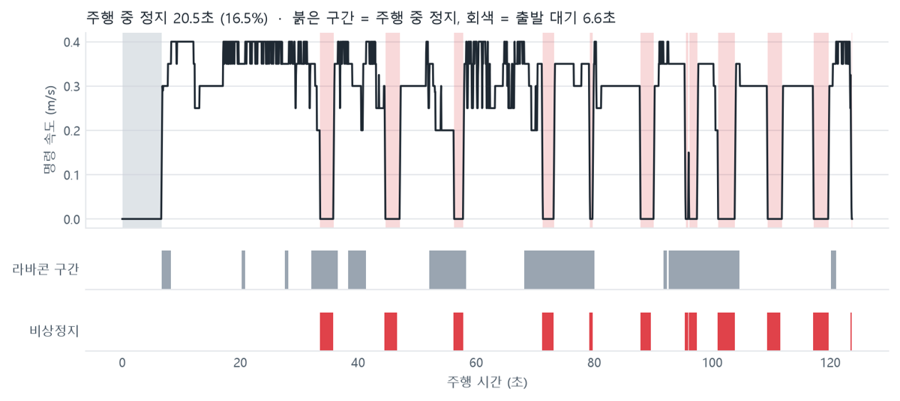
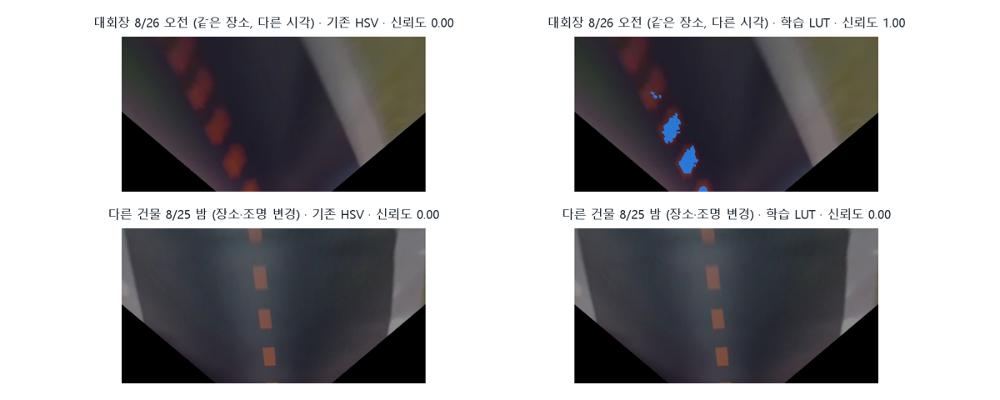
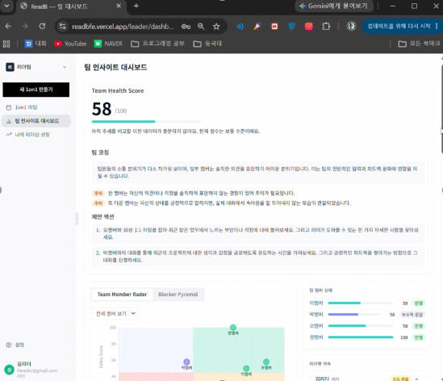
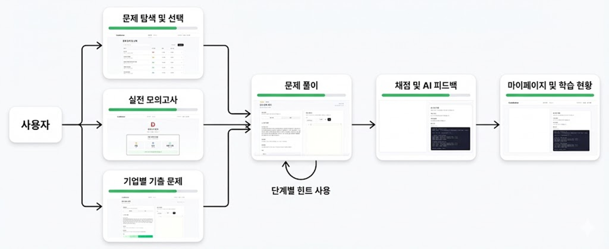
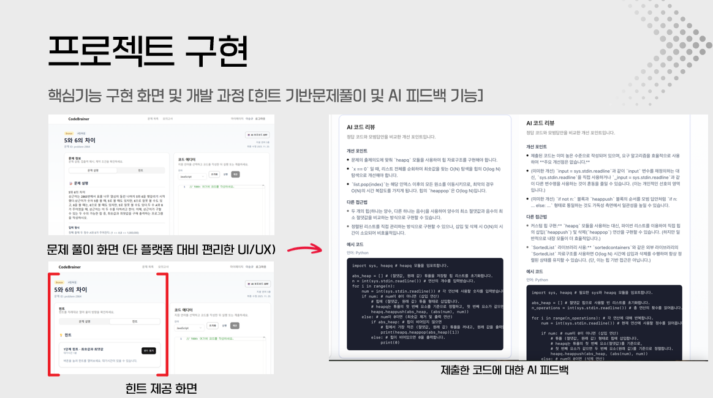
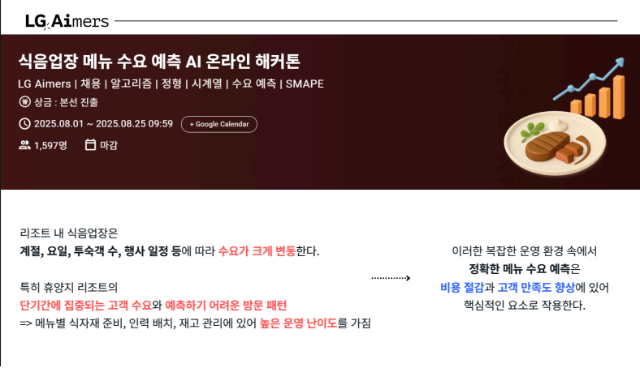
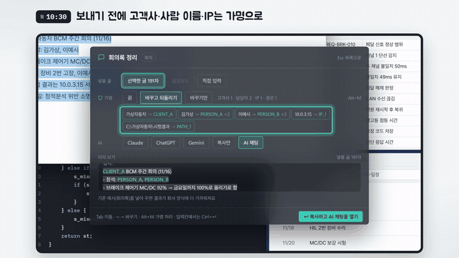

  

# 👨‍💻 이승규 (Lee Seung-gyu) | AI Engineer · Full-stack Developer · PM

> **"데이터로 실패 원인을 찾고, AI를 실제로 돌아가는 서비스로 엮어냅니다."**

대부분의 프로젝트와 팀 활동에서 **백엔드**를 맡아 왔고, 지금은 **LLM 에이전트를 만들고 평가하는 일**을 하고 있습니다.
데이터와 AI를 다루는 일에 관심이 많고, 최근에는 하드웨어와 소프트웨어를 잇는 일에 끌려 자율주행 해커톤에도 나갔습니다.
잘하는 일은 기획과 백엔드 개발, 그리고 **실패한 이유를 데이터로 찾아 숫자로 설명하는 것**입니다.

  
  
  

## 🚀 Featured Projects

| # | 프로젝트 | 기간 | 역할 | 한 줄 결과 |
|:-:|---|:-:|---|---|
| 01 | [해양 GIS 자연어 검색 에이전트](#01--해양-gis-자연어-검색-에이전트) | 26.09~현재 | 에이전트 설계·구현·평가 전담, AI 패널 UI | 처음 보는 질문 64건 작업 선택 정확도 **0.938** |
| 02 | [AI 에이전트 평가 프레임워크](#02--ai-에이전트-평가-프레임워크) | 26.09~현재 | 평가지표 체계 | 제안한 판정 원칙이 **정의서에 반영** |
| 03 | [AMET 2026 자율주행 해커톤](#03--amet-2026-자율주행-해커톤) | 26.07~08 | 인지(Perception)·팀 코드 통합 | 실패 원인 결함 **5개**를 수치로 특정 |
| 04 | [ReadB · 1on1 미팅 분석 HR 대시보드](#04--readb--1on1-미팅-분석-hr-대시보드-mvp) | 26.04~06 | 팀장(PM)·백엔드·AI 파이프라인 | 백엔드 PR 66건 중 **65건** 머지 |
| 05 | [CodeBrainer · AI 코딩 학습 플랫폼](#05--codebrainer--ai-피드백-코딩-학습-플랫폼) | 25.10~12 | 백엔드·DB·테스트케이스·발표 | Flyway 마이그레이션 **5개**, 학습 통계 SQL |
| 06 | [LG Aimers 7기 수요 예측 해커톤](#06--lg-aimers-7기--메뉴별-수요-예측-해커톤) | 25.07~08 | 팀장·전처리·모델 분석 | SMAPE **0.515**, 참가팀 **상위 12%** |

---

### 01 · 해양 GIS 자연어 검색 에이전트
슈어소프트테크 인턴 · 공공 컨소시엄 과제 · 진행 중

상황실 근무자가 **말로 물으면 선박 목록과 지도로 답하는** 검색 에이전트입니다. 선박 위치 데이터와 협력사 데이터를 **MCP로 연동**해 LLM(A.X 모델)로 항적 AI 에이전트를 개발하고, 통합 플랫폼의 **AI 패널 UI**도 만들었습니다.

- **설계 원칙:** LLM은 질문을 작업 9종·조건 6축 JSON으로 바꾸는 일만 맡고, 해역 경계 같은 업무 판정은 법령 기반 정의표로 코드가 결정
- **운영 장치:** 동명 선박 되묻기, 결과 0건일 때 사유 안내, 범위 밖 질문 거절, 직전 결과 참조("이 배"), 상황 재생
- **평가:** 프롬프트를 보지 않은 에이전트가 만든 독립 시험셋 사용. 프롬프트가 한 모델에 유리하게 다듬어진 것을 중립 재측정으로 확인(p=0.006)하고 모델별 개정 기회를 똑같이 주는 공정 비교 절차 설계
- **판단:** 해양 도메인 어댑터를 GIS 질의 176건으로 직접 재 보고 정확도 3.4%p 하락을 확인해 미채택
- **UI:** 질의와 답변 공간 분리, 개체 유형별 지도 아이콘(선박은 원형, 함정·항공기는 방패형), 운항 중인 개체의 이동 방향 표시, 중간보고 시연 영상(시나리오 3개, 3분) 제작

  
  
  
  

수치는 실데이터 연동 전 합성 데이터 기준입니다. 회사 프로젝트라 코드와 화면은 공개하지 않습니다.

`Python` `FastAPI` `transformers` `MCP` `SQLite` `Leaflet` `Docker`

---

### 02 · AI 에이전트 평가 프레임워크
슈어소프트테크 인턴 · 공공 컨소시엄 과제 · 진행 중

결제·예약처럼 **실제로 일을 처리하는 AI 에이전트**를 믿고 맡겨도 되는지 판정하는 평가 기준을 만드는 과제에서 **평가지표 체계**를 맡았습니다. ISO/IEC 25010·25059, OWASP, NIST 자료와 다른 도메인의 체계를 참고해 프레임워크의 타당성을 보완했습니다.

- 지표 매트릭스 30칸을 실제 시험 데이터와 대조해 온전히 측정되는 칸이 5칸뿐임을 확인하고 원인 규명
- 차단율·오차단율 짝 보고, K회 반복 중 1회 위반 시 불합격, 측정 대상이 없으면 '계산 불가'로 두는 판정 원칙 제안 → 팀 정의서에 반영
- 기능 안전 표준의 **SIL**에서 착안해 에이전트를 위험 등급으로 나누는 절을 설계하고, 실제 기업 에이전트가 **워크플로형·자율형**으로 나뉜다는 점을 반영해 평가 대상 분류 체계 구성
- 추가 시험 수량(유형당 30건)의 통계 근거를 Rule of Three·IEC 61508-7 표로 교차 확인해 한 장 자료로 정리

`ISO/IEC 25010` `ISO/IEC 25059` `OWASP Agentic Top 10` `IEC 61508` `τ-bench`

---

### 03 · AMET 2026 자율주행 해커톤
한국자율주행산업협회 주최 · 4인 팀 · 26.07 ~ 26.08.27 (대회 26.08.25 ~ 27)

  

Raspberry Pi 5 위에서 도는 규칙 기반 자율주행차를 만들었습니다. 시뮬레이터에서는 완주했지만 대회장에서는 구간 이탈이 잦았고 예선에서 탈락했습니다. 마지막 연습 주행에서 기록한 **rosbag 124초**를 분석해 원인 결함 **5개**를 수치로 찾았습니다. 처음 도전하는 분야였지만, 관심 있는 분야는 직접 뛰어들어야 배울 수 있다고 생각했습니다.

| 찾은 문제 | 고친 방법 | 결과 |
|---|---|---|
| 출발 대기를 뺀 주행 중 **16.5%** 정지 | 비상정지 교착 원인 특정, 탈출 조건과 회귀 테스트 추가 | 교착 재발 방지 |
| 직선 주행 떨림 | heading 계산 방식 변경, 탑뷰 축척 실측 보정 | 떨림(95%) **20.83° → 4.21°** |
| 급커브에서 차선 놓침 | 탑뷰 시야 확장 | 저신뢰 프레임 **58.8% → 30.4%** |
| 조명 변화에 약한 색 기준 | 사람 라벨 없이 학습한 색 판정을 180KB 룩업 테이블로 | 프레임당 **2.15ms**, 같은 장소 다른 시각 **43.3% → 61.7%** |
| 조향 라벨 부족 | IMU로 키보드 조향 기록(3단계)을 연속 조향 라벨로 복원 | 학습용 라벨 확보 |

  
  

<b>배운 점</b>

- 시뮬레이터에서 완주한 코드는 대회장의 조명과 카메라 노출을 버티지 못했습니다. 첫날부터 실차 주행을 기록했어야 했습니다.
- 규칙 기반을 택한 것만이 탈락 원인은 아니었습니다. 정지 교착이나 탑뷰 축척처럼 방식과 무관한 결함도 컸습니다.
- 학습 색 판정은 다른 건물에서는 효과가 없었습니다. 개선 수치는 모두 실차 기록을 다시 돌려 본 오프라인 검증입니다.

**Case study →** [leegyu-git.github.io/2026AMET](https://leegyu-git.github.io/2026AMET/) · **Repo →** [LEEGYU-GIT/2026AMET](https://github.com/LEEGYU-GIT/2026AMET)

`Python` `OpenCV` `scikit-learn` `ROS2 Jazzy` `rosbag2` `pytest` `Raspberry Pi 5`

---

### 04 · ReadB · 1on1 미팅 분석 HR 대시보드 MVP
동국대 종합설계 · 4인 팀 · 26.04 ~ 26.06.12 · 팀장(PM) 및 백엔드

<table>
<tr>
<td width="42%"></td>
<td>

1on1 미팅 녹음을 분석해 팀원이 서베이에 적은 상태와 **실제 대화 속 행동의 차이**를 수치로 보여 주는 B2B HR SaaS입니다.

- PRD v2.5까지 관리하고 파일 단위 소유권·브랜치 규칙으로 통합 충돌 정리, 백엔드 PR 66건 중 65건 머지
- 녹음 업로드 즉시 202를 돌려주고 STT → 발화 분류 → 점수 산정을 비동기로 잇는 AI 파이프라인 설계
- LLM이 100점 만점에 **133점**을 내던 점수를 원인 세 곳부터 고쳐 재보정하고, 점수 계산을 서버로 옮겨 설명 가능한 점수로 전환
- 리더 발화 비율을 색으로 알려 주는 ESP32 램프 제작

**MVP →** [readbfe.vercel.app](https://readbfe.vercel.app) 
**Repo →** [Front-end](https://github.com/Team-A-ing/FE) · [Back-end](https://github.com/Team-A-ing/BE)

</td>
</tr>
</table>

`Java` `Spring Boot` `PostgreSQL` `Supabase` `Railway` `Vercel` `OpenAI API` `Whisper`

---

### 05 · CodeBrainer · AI 피드백 코딩 학습 플랫폼
수업 팀 프로젝트 · 25.10 ~ 25.12.12 · 발표 및 백엔드

단계별 힌트와 AI 피드백으로 스스로 풀게 돕는 알고리즘 학습 플랫폼입니다.

- 채점 기준이 되는 테스트케이스·제출 테이블 설계, Flyway 마이그레이션 5개 작성
- 기준 버전이 다른 DB에서도 깨지지 않게 중간 마이그레이션과 재실행 안전 스크립트 작성
- 제출 기록을 SQL로 집계해 알고리즘 분류별 정답률, 오답 목록, 1·3·7·14·30일 간격 복습 추천 구현

<b>화면 보기</b>

**MVP →** [code-brainer.vercel.app](https://code-brainer.vercel.app) · **Repo →** [LEEGYU-GIT/CodeBrainer](https://github.com/LEEGYU-GIT/CodeBrainer)

`Java` `Spring Boot` `PostgreSQL` `Supabase` `Flyway` `Next.js` `Judge0`

---

### 06 · LG Aimers 7기 · 메뉴별 수요 예측 해커톤
온라인 해커톤 · 25.07 ~ 25.08.25 · 팀장

<table>
<tr>
<td width="46%"></td>
<td>

리조트 식음업장의 메뉴별 다음 7일 판매량을 예측했습니다.

- 매출 0이 이어지는 구간을 '영업하지 않은 기간'으로 해석해 무판매 피처 5개 설계
- 실제 판매량 0인 날을 빼는 대회 산식에 맞춰 SMAPE 학습 손실을 직접 정의
- 이동 평균을 전날까지의 값으로만 계산해 미래 정보 누수 차단

**결과:** SMAPE **0.515**, 참가팀 **상위 12%** (Private 기준)

**Repo →** [LG-Aimer-7th-our-team](https://github.com/LEEGYU-GIT/LG-Aimer-7th-our-team)

</td>
</tr>
</table>

`Python` `PyTorch` `pandas` `scikit-learn`

---

### ✨ 그 외 · Sure-Mate
업무 자동화 도구 · 1인 개발 · 개선 중

  

회의록·주간보고·메일 회신처럼 AI에 맡기는 반복 업무를 **단축키 한 번**으로 줄이는 Windows 도구입니다. 업무용 프롬프트 9종으로 글을 조립하고, 고객사·사람 이름과 IP는 가명으로 바꿔 보낸 뒤 AI 답에서 원래 이름으로 되돌립니다. 서버 없이 PC 안에서만 동작합니다.

**Repo →** [LEEGYU-GIT/SURE_MATE](https://github.com/LEEGYU-GIT/SURE_MATE) &nbsp; `Electron` `React` `TypeScript` `Win32 (koffi)` `Vitest`

## 🛠 Tech Stack

### Backend & BaaS
     

### AI & Data
     

### Robotics & Embedded
    

### Frontend & Infrastructure
     

### Activities & Certificates

| 활동 · 수료 | 자격 |
|---|---|
| 슈어소프트테크 AI 인턴 (26.09 ~ 26.12) · 프로젝트 외 블랙박스 테스트 등 검증 업무 | 정보처리기사 (2026.09) |
| AMET 2026 자율주행 해커톤 (26.08) · 인지·통합 담당 | ADsP 데이터분석 준전문가 (2026.03) |
| LG Aimers 7기 수료 · 해커톤 상위 12% | 컴퓨터활용능력 2급 (2024.06) |
| 학술 동아리 Farm System 4기 인공지능 트랙 수료 | 자동차운전면허 1종 보통 |
| 상상그라운드 AI 상상클래스 수료 · 디지털 경진대회('생성형 AI와 인간의 텍스트 판별') 참가 | |

## 🔗 Links

  
  
  

